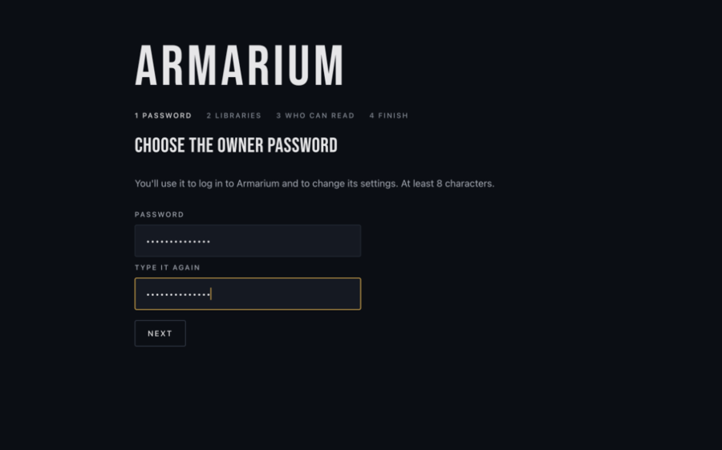
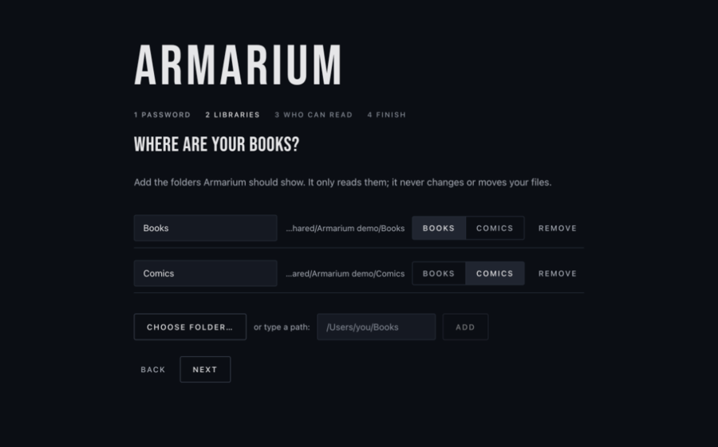
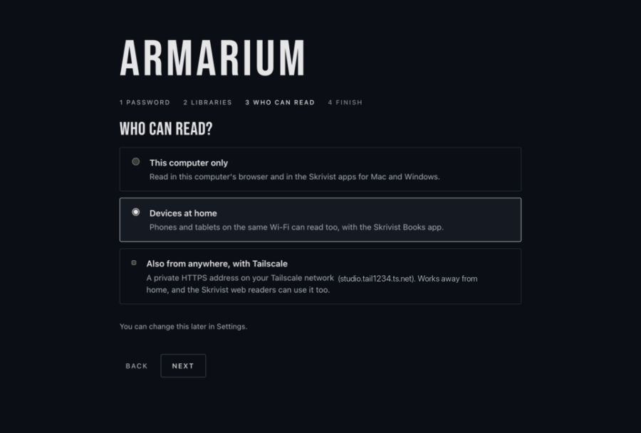

# Install Armarium on Windows

Armarium serves the books and comics on your PC to your browser, your phone and
your tablet. It runs quietly in the notification area of the taskbar while
you're signed in. You don't need administrator rights, a command prompt or a
configuration file.

## What you need

- Windows 10 (version 1809 or later) or Windows 11, 64-bit.
- The folder that holds your books, comics or Calibre library. It can be on
  another drive or a mapped network drive.
- To read on a phone or tablet: the **Skrivist Books** app
  ([Google Play](https://play.google.com/store/apps/details?id=ist.skriv.books);
  the App Store version is in review) or the Skrivist web readers.

## 1. Download

Download **Armarium-Setup-X.Y.Z-x64.exe** from
[armarium.skriv.ist](https://armarium.skriv.ist/) or the
[latest release](https://github.com/c0ze/armarium/releases/latest).

## 2. Install

1. Open the downloaded file.
2. Windows may show **"Windows protected your PC"**. This happens because the
   installer isn't yet signed with a certificate Windows recognises. Click
   **More info**, then **Run anyway**.
3. The installer copies Armarium into your user account. It doesn't ask for an
   administrator password. On the last page, leave **Start Armarium** ticked and
   click **Finish**.

To check the download first, compare its SHA-256 with the one in
`checksums.txt` on the release page: in PowerShell,
`Get-FileHash .\Armarium-Setup-X.Y.Z-x64.exe`.

## 3. Find Armarium

Armarium has no window. Its book icon sits in the notification area at the right
end of the taskbar. If you don't see it, click the **^** arrow there; you can
drag the icon onto the taskbar to keep it in view. Your browser opens the setup
page by itself the first time.

If the browser didn't open, click the book icon and choose **Open Armarium**.

## 4. Set it up

The setup page asks four things:

1. **The owner password.** You use it to log in and to change settings. Choose
   one with at least 8 characters.

   
2. **Where your books are.** Click **Choose folder…** and pick a folder. Add as
   many as you like. Mapped network drives (such as `Z:`) work too. Armarium works
   out whether each one holds books, comics or a Calibre library; you can change
   that with the Books/Comics switch. Armarium only reads these folders. It never
   changes, moves or deletes your files.

   
3. **Who can read.**
   - **This computer only**: your browser on this PC, and the Skrivist apps for
     Mac and Windows.
   - **Devices at home**: phones and tablets on the same Wi-Fi as well.
   - **Also from anywhere, with Tailscale**: see
     [Read anywhere](#read-anywhere-with-tailscale) below.

   
4. **Start Armarium when you log in.** Leave this on, so your library is there
   whenever the PC is.

Click **Start reading**. Armarium reads through your folders and shows your
library. A large library takes a few minutes the first time; you can start
reading meanwhile.

If you chose **Devices at home**, Windows Security asks whether to allow
Armarium on networks. Tick **Private networks** and click **Allow**. (If you
missed it: Windows Security → Firewall & network protection → Allow an app
through firewall → Change settings → tick **Private** next to Armarium.)

## 5. Read on your phone or tablet

1. In Armarium's Settings, **Who can read** must be **Devices at home**.
2. Install Skrivist Books on the phone. The phone must be on the same Wi-Fi as
   the PC.
3. Click the book icon in the taskbar and choose **Pair a phone…**.
4. Pick the device, then click **Skrivist Books app (iPhone, iPad, Android)**. A
   QR code appears.
5. In Skrivist Books on the phone, tap **Add library**, then **Scan QR code**, and
   point it at the QR code.

The phone can read whenever the PC is awake and Armarium is running. To keep the
PC from sleeping while it's plugged in, look in Settings → System → Power.

Your PC's address on the home network can change, for example after the router
restarts. Armarium keeps up by itself, but a phone paired with the old address
can't find it. If that happens, pair the phone again. To keep the address the
same, reserve it for the PC in your router's settings ("DHCP reservation").

### Read anywhere, with Tailscale

[Tailscale](https://tailscale.com/) is a free private network that connects
your own devices wherever they are. With it, your phone can read from the PC
when you're away from home, over a secure HTTPS address, and the Skrivist web
readers (books.skriv.ist and comics.skriv.ist) can use it too.

1. Install Tailscale on the PC and on the phone, and sign in to the same account
   on both.
2. In the Tailscale admin console, open **DNS** and turn on **HTTPS
   Certificates**.
3. In Armarium's Settings, tick **Also from anywhere, with Tailscale** and click
   **Save and restart**.
4. Pair the phone again from **Pair a phone…**. The QR code now carries the
   Tailscale address.

Armarium only adds itself at the root of your PC's Tailscale address. If
something else already uses that address, Armarium leaves it alone and says so.

## Add more folders later

Click the book icon and choose **Settings…**. You can add folders, rename a
library (its reading progress stays), remove one, change who can read, or change
the password. **Save and restart** applies the changes; Armarium restarts in a
second or two.

Removing a library deletes its reading progress from Armarium. Your files stay
where they are.

## Update

Download the new installer and run it. It closes Armarium, updates it and starts
it again. Your settings, libraries and reading progress are kept.

## Uninstall

Open Settings → Apps → Installed apps, find **Armarium**, and choose
**Uninstall**. If Armarium is running, the uninstaller asks you to quit it first
(book icon → **Quit Armarium**).

At the end it asks whether to delete your Armarium settings and reading progress
as well. Choose **No** to keep them for a later reinstall. Your book and comic
files are never touched.

If you turned on Tailscale, also run this once in a command prompt:

```bat
"%ProgramFiles%\Tailscale\tailscale.exe" serve --https=443 --set-path=/ off
```

## Forgot the password?

Open a command prompt (search for **cmd** in the Start menu) and run:

```bat
"%LOCALAPPDATA%\Programs\Armarium\cli\armarium.exe" --config "%LOCALAPPDATA%\Armarium\armarium.toml" password
```

Type the new password twice. Browsers that were logged in have to log in again;
paired phones keep working.

## If something goes wrong

- **The menu says "Port 8580 is in use by another program".** Another program,
  perhaps another copy of Armarium, uses Armarium's port. Quit it, or choose
  another port in Settings.
- **The phone can't connect.** Check that the phone is on the same Wi-Fi, that
  Settings says **Devices at home**, that the PC is awake, and that Armarium is
  allowed on private networks in the firewall (see the end of
  [Set it up](#4-set-it-up)).
- **More detail:** the book icon → **Show log folder** opens Armarium's log.
  Include it when you [report a problem](https://github.com/c0ze/armarium/issues).

## Where Armarium keeps its files

| What | Where |
|---|---|
| The program | `%LOCALAPPDATA%\Programs\Armarium` |
| The command line | `%LOCALAPPDATA%\Programs\Armarium\cli\armarium.exe` |
| Settings (`armarium.toml`) | `%LOCALAPPDATA%\Armarium` |
| Library database and cover cache | `%LOCALAPPDATA%\Armarium\data` |
| Log | `%LOCALAPPDATA%\Armarium\logs` |

`armarium.toml` is written by Armarium. Quit Armarium before you edit it by hand.
